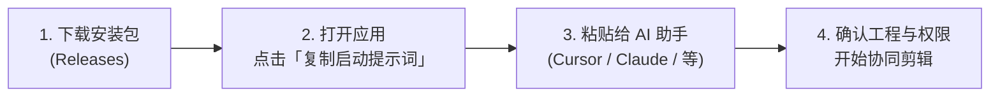
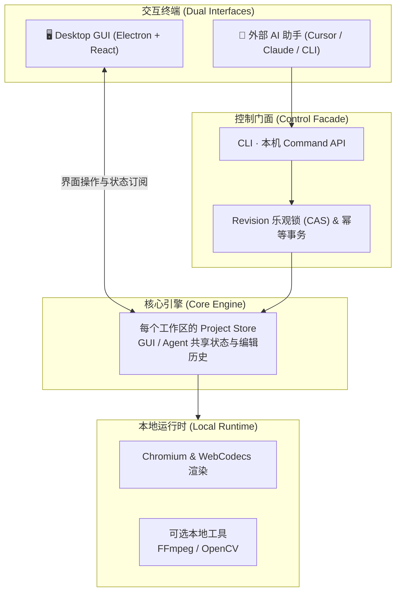

<div align="center">

[English](README_en.md) | **简体中文** &nbsp;·&nbsp; 🧪 [审阅工作台 (实验性)](README_review.md)


# ReelTerminal

### 面向 AI 视频生产的人机协同视频剪辑器
**生成发生在任何地方，成片交付在这里。**  
*Generate anywhere; finish here.*

<p align="center">
  <a href="https://github.com/yuchen-ya/reelterminal/releases"></a>
  <a href="docs/EXTERNAL-DEPENDENCIES.md"></a>
  <a href="apps/desktop/DISTRIBUTION.md#build"></a>
  <a href="https://github.com/yuchen-ya/reelterminal/issues"></a>
  <a href="LICENSE"></a>
</p>

[**🚀 快速开始**](#-快速开始-quick-start) • [**✨ 核心特点**](#-核心特点-core-features) • [**🧪 审阅工作台**](README_review.md) • [**🤖 Agent 指引**](#-面向-ai-agent-的快速指引-for-ai-agents) • [**🏗️ 架构概览**](#-系统架构-architecture) • [**📚 详细文档**](#-详细文档-documentations)

</div>

---

## 💡 为什么做 ReelTerminal？

当下各类视频生成模型极大地降低了素材创作门槛，但在**碎片化的生成片段**与**最终想要的完整成片**之间，仍有很多繁琐的手工活：

* **素材零散**：几秒一段的视频、分批生成的配音、单独挑选的配乐散落各处，需要挑选版本、精准拼接、调速、转场和音画对位；拼起来后，还要处理音量落差、口播空白和配乐遮挡人声。
* **局部坏帧与瑕疵**：AI 生成的帧容易偶发闪烁、局部变形或伪影，若整段重新抽卡成本很高，更需要“定点修补”。
* **缺乏顺手的 AI 协同环境**：传统剪辑软件对大模型助手来说并不友好；而普通的脚本批处理又看不到画面、无法交互和撤销。

**ReelTerminal 试图提供一个平滑的折中解法：**  
保留现代剪辑器直观的画布和时间线，创作者可以在桌面端随手拖拽微调；同时让你的 AI 助手（Cursor、Claude、Antigravity 等）能直接操作工程时间线——**你主导创作和最终取舍，AI 负责批量与结构化处理；双方共享工程状态、编辑历史、版本存档和画面对比。**


*真实宣传片工程截图：展示素材库、播放器、多轨时间线、R 片段引用标记与存档记录，顶部可切换至审阅工作台。*

---

## ✨ 核心特点 (Core Features)

| 🤖 **面向 AI 助手协同设计** | 🎯 **逐帧审查与局部修补** |
| :--- | :--- |
| 为 AI 辅助剪辑定制了严谨的时间线接口，支持原子批处理、CAS 乐观锁与防重复提交，帮助 AI 助手可靠地执行复杂剪辑并检测冲突。内置双语操作手册供 Agent 按需检索，减少对界面操作的猜测。 | 使用 **0-based 解码帧索引** 与真实 PTS 时间戳定位画面，支持帧提取、接触表、区域补丁及对比。配置本地 OpenCV 后可使用光流跟踪与掩码工具。 |
| 🌿 **不可变版本节点与画面对比** | 🔒 **本地优先与受控素材存储** |
| 工作区保存与版本留存分开：保存当前编辑，或建立存档点用于只读预览、画面对比和后续采用。每个工作区保有独立状态，创作者决定是否采用 Agent 的试剪结果。 | 工程、素材缓存、编解码和渲染在本机处理，素材通过哈希引用与受控存储管理。模型、字体下载及可选在线服务按配置联网，外部 AI 助手由用户自行选择。 |

### 🆕 v1.3.9 更新概览

- **音频变速与工程管理**：恒定变速默认保留音高，可显式关闭；修复 seek 后音频重复启动。工程支持另存、定位、回收管理及清理前预览确认。
- **目标绑定与 CLI 按需发现**：单行 `start --target <ref>` 固定绑定工作区或审阅任务，不含凭据；通过 `tools` 与 `describe` 按需查询能力和命令。
- **审阅与私有自由画板（实验性）**：统一标签管理审阅任务与画板，支持图片、文本、视频、GLB、Markdown、HTML 和隔离网页浏览；改进窄窗口编辑、撤销和媒体交互。修补、截帧与主动导出详见 🧪 **[独立说明](README_review.md)**。

详细变更与验证记录请参阅 [1.3.9 构建说明](docs/RELEASE-1.3.9.md)、[1.3.8 构建说明](docs/RELEASE-1.3.8.md)、[1.3.6 构建说明](docs/RELEASE-1.3.6.md) 与 [Releases 页面](https://github.com/yuchen-ya/reelterminal/releases)。

### 🎙️ 本地字幕与音频整理

- **本地语音转字幕**：支持基于 Qwen（默认）或 SenseVoice + Qwen 词级时间对齐生成本地字幕，可自动识别语言或指定中文，支持批量修改与一键整体撤销。
- **量化音频分析与修剪**：Agent 可测量并统一响度（LUFS）、识别人声（VAD）与静音区间、自动裁剪气口、在人声段智能压低配乐（Ducking）或按节拍卡点切片；进阶支持降噪、人声/伴奏分离、匿名说话人聚类与多轨同步偏移估计。所有分析仅产出结构化记录，需经显式命令才会修改时间线。
- **环境自检与指令复用**：应用「设置」面板内置 Python、模型与音频工具环境自检，可一键复制配置说明交由 Agent 协助排查；内置协作指令库方便保存与复用常用任务提示词。

> 💡 **使用建议**：安装包不捆绑外部大模型，也不会在后台自动执行 `pip`。首次使用字幕或进阶音频功能时，建议先用短片段测试效果与环境配置。具体边界请参阅 [用户手册](docs/USER-GUIDE.md)、[素材分析说明](docs/MATERIAL-ANALYSIS.md) 与 [响度规范化](docs/AUDIO-NORMALIZATION.md)。

---

## 🚀 快速开始 (Quick Start)

### 方式一：直接使用桌面端（推荐 · 无需开发配置）



1. 前往 **[Releases 页面](https://github.com/yuchen-ya/reelterminal/releases)** 下载对应系统的安装包。
2. 打开视频工程。需要 AI 助手修改时间线时，在时间线上方将协作权限由只读切换为 **`可编辑`**（可随时切回只读）。
3. 点击通知中的 **「复制启动提示词」**，粘贴给具备本机命令行能力的 AI 助手。
4. 助手会运行提示词中的 `start --target` 命令读取绑定的工程上下文，按需发现工具并在与你确认目标工程与工作区后执行剪辑；你可在同一界面实时预览、微调或对比版本。

#### 安装与升级须知

- **平台支持**：最新本地构建为 **v1.3.9 Windows x64** 安装版与便携版 ZIP（请完整解压后运行 `ReelTerminal.exe`），公开下载版本以 [Releases 页面](https://github.com/yuchen-ya/reelterminal/releases) 为准。macOS Apple Silicon 用户可暂用历史版本 [v1.2.1](https://github.com/yuchen-ya/reelterminal/releases/tag/v1.2.1)（不含后续更新）。
- **旧版升级与安全提示**：旧版 Windows 用户升级前请务必阅读 [Windows 升级与备份指南](docs/WINDOWS-UPGRADE.md)，建议先备份并优先将新版 ZIP 解压至全新目录使用。Windows 构建可能未附带商业代码签名，若遇 SmartScreen 提示，请确认包文件来自官方 Releases 并核对 SHA-256。
- **可选本地工具**：部分导出、媒体分析与光流修补功能依赖本机 `FFmpeg/ffprobe` 或含 `cv2`/`numpy` 的 Python 环境，详见 [外部依赖说明](docs/EXTERNAL-DEPENDENCIES.md)。

---

### 方式二：开发者源码构建与启动

使用 Node.js 22.13.0 或更新版本，以及仓库固定的 pnpm 11.7.0。示例先启用 Corepack，确保构建脚本也能找到 `pnpm` 命令：

```bash
git clone https://github.com/yuchen-ya/reelterminal.git
cd reelterminal

corepack enable
corepack pnpm install --frozen-lockfile
corepack pnpm build:wasm
corepack pnpm --filter @reelterminal/desktop build
corepack pnpm --filter @reelterminal/desktop start

# 可选：启动浏览器开发服务器
corepack pnpm dev
```

开发检查和可选工具配置见 [CONTRIBUTING.md](CONTRIBUTING.md)，打包命令见[桌面构建说明](apps/desktop/DISTRIBUTION.md#build)。

---

## 🤖 面向 AI Agent 的快速指引 (For AI Agents)

如果你是正在阅读本仓库的 AI 助手（Claude、Cursor、Antigravity、Codex 等），请先根据任务类型选择对应的工作流与规范文档：

| 任务场景 | 适用规范与入口 | 核心执行契约 |
| :--- | :--- | :--- |
| **🎬 视频剪辑与多模态审阅**<br>（协同操作桌面端工程或审阅任务） | • [Agent 协作指南](docs/AGENT-GUIDE.md)<br>• [任务工作区规程](docs/AGENT-WORKSPACE.md)<br>• [Command API 规范](docs/COMMAND-API.md)<br>• [审阅工作台指南](README_review.md) | 1. **连接与按需发现**：优先执行复制的 `start --target <ref>`（或 `reelctl status` / `context --compact`），再用 `tools <domain>` 与 `describe <verb>` 按需查询契约；严禁打印或泄露 `live-endpoint.json` 及其 Token。未开启写权限时请提示用户开启。<br>2. **显式目标绑定**：读写命令须绑定明确的 `projectId`/`workspaceId`（或审阅 `target`）及版本锁（`expectedRevision`），勿因 GUI 焦点或标签切换而静默变更目标。私有自由画板默认不对 Agent 开放。<br>3. **产物隔离**：调用 `reelctl call capabilities.get` 获取 `mediaImport.recommendedRoot`，将生成媒体、抽帧与中间脚本统一置于 `jobs/<YYYY-MM-DD>-<slug>/` 下，**严禁写入源码仓库目录**。 |
| **🛠️ 仓库源码开发与测试**<br>（修改代码、修复 Bug、打包） | • [仓库 Agent 规则 (AGENTS.md)](AGENTS.md)<br>• [贡献与开发指南](CONTRIBUTING.md)<br>• [桌面端 E2E 测试](apps/desktop/e2e/README.md) | 1. **与用户实例隔离**：源码修改、单元测试与构建无需连接或探测用户正在运行的桌面端；GUI 回归测试必须使用 `apps/desktop/e2e` 提供的隔离配置。<br>2. **历史与状态边界**：整工程替换须走 `ProjectState.loadProject`；持久化状态修改须通过 Store 的标准提交通道（保留 `ActionHistory.nextSequence` 顺序），切勿滥用 `rawSet`。<br>3. **单工作区协作**：不擅自新建 Git worktree；修改前先检查 `git status`，保留工作区内已有的未提交变更。 |

> 📌 **重要状态边界提示**：
> - **分析与编辑分离**：响度测量、VAD、静音探测、节拍检测等命令仅生成分析记录，不会自动改动时间线；必须调用对应的显式剪辑命令（如 `clip.cutSilenceFromAnalysis`、`clip.setDuckingFromAnalysis`）才会生效。
> - **历史与撤销边界**：检查器中的 3D 属性调整不单独计入撤销栈；在进行大范围试剪或不可逆调整前，建议先创建版本存档点（Retain Version Node）。工程模板仅保存结构快照，不打包全部源媒体文件。

---

## 🏗️ 系统架构 (Architecture)



---

## 💬 交流与反馈 (Feedback)

ReelTerminal 面向需要整理、修补并交付 AI 视频的创作者，由独立开发者维护。欢迎反馈真实创作中的问题和需求。

可以通过 Issues 反馈：

- 遇到了 bug 或奇怪的交互体验？
- 有某个剪辑工作流特别希望得到支持？
- 对时间线或 AI 协作交互有更好的想法？

欢迎在 **[GitHub Issues](https://github.com/yuchen-ya/reelterminal/issues)** 附上操作步骤和必要的脱敏信息；安全问题请使用 [SECURITY.md](SECURITY.md) 中的私密报告渠道。

---

## 📚 详细文档 (Documentations)

使用指南、开发说明与发行信息：

- 📖 [**桌面端用户手册**](docs/USER-GUIDE.md) — 桌面端安装、界面导览与常用操作。
- 🧪 [**审阅工作台与私有自由画板 (实验性)**](README_review.md) — 多模态批次审阅、像素修补、Handoff 返工与 [自由画板操作说明](docs/HUMAN-BOARDS.zh-CN.md)。
- 🌿 [**多项目与版本节点指南**](docs/MULTI-PROJECT-USAGE.md) — 紧凑版本轨道、保存与留存分离（Save vs Retain）、只读预览与画面对比。
- 📐 [**版本节点交互规范**](docs/VERSION-NODES-UX.md) — 存档树、采用（Adopt）、回收与冲突保护设计准则。
- 🤖 [**外部 Agent 协作指南**](docs/AGENT-GUIDE.md) — 权限机制、CLI 详解与进阶接口。
- 🗂️ [**任务工作区规程**](docs/AGENT-WORKSPACE.md) — 独立工作目录规程与落盘准则。
- ⚙️ [**Command API 规范**](docs/COMMAND-API.md) — 命令目录、Schema 校验与并发控制。
- 🎞️ [**媒体审查与修复流**](docs/MEDIA-REVIEW-WORKFLOWS.md) — 逐帧提取、接触表与光流运动追踪。
- 🎨 [**色彩管理白皮书 (SDR)**](docs/COLOR.md) — BT.709 与 BT.601 颜色转换规范。
- 🌐 [**外部依赖与联网行为**](docs/EXTERNAL-DEPENDENCIES.md) — 本地工具、资源下载及可选在线服务。
- 📦 [**发行与更新说明**](https://github.com/yuchen-ya/reelterminal/releases) — 安装包、修复范围、签名与校验信息。

---

## ⚖️ 开源协议与鸣谢 (License & Attribution)

* 本项目核心代码基于 [MIT License](LICENSE) 开源发布。
* 本项目继承并改造自 Augustus Otu 及贡献者开源的 MIT 协议项目 [OpenReel](https://github.com/Augustus-Otu/openreel)，原始版权声明予以完整保留。
* 第三方组件、字体与模型授权审查详情请参阅 [THIRD_PARTY_NOTICES.md](THIRD_PARTY_NOTICES.md)。
