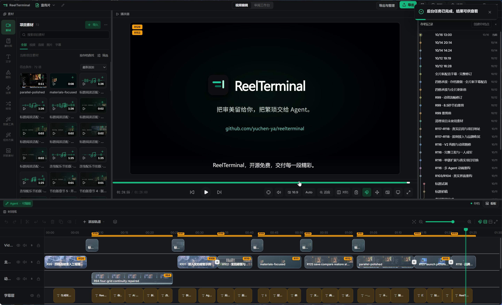

<div align="center">

[English](README_en.md) | **简体中文** · [审阅工作台](README_review.md)


# ReelTerminal

面向 AI 视频生产的人机协同剪辑器。生成发生在任何地方，成片打磨在这里。

[下载桌面版](https://github.com/yuchen-ya/reelterminal/releases) · [用户手册](docs/USER-GUIDE.md) · [反馈问题](https://github.com/yuchen-ya/reelterminal/issues)

</div>

ReelTerminal 把时间线、预览画面和外部 AI 助手连接到同一个视频工程。你负责创作判断、预览和细调，助手负责批量或结构化编辑；双方共享视频工程状态、编辑历史和版本对比。



## 视频编辑能力

| 工作 | 能力 |
| --- | --- |
| 视频剪辑与交付 | 在时间线组织素材、调整片段与音频、预览和导出；常速变速默认保持音高，支持逐帧检查和版本对比。 |
| 与外部 AI 助手协作 | 将应用提供的启动提示交给有本地命令执行能力的助手。CLI 按需发现工具，通过明确目标、版本检查和可撤销编辑协作。 |
| 字幕与音频整理 | 使用本地 Qwen 或 SenseVoice 生成字幕；按需进行响度、语音活动、静音、节拍等分析，再明确应用到时间线。 |

工程、素材缓存、编辑和渲染以本地运行。模型下载、外部网页和可选网络服务的边界见[外部依赖说明](docs/EXTERNAL-DEPENDENCIES.md)；AI 助手由你自行选择和配置。

## 1.4.2 更新

- 修复源视频帧选择与解码缓存复用，减少跳帧和素材替换后的旧帧问题。
- 统一播放、暂停预览、CLI 截图和导出的时间线渲染，改善字幕、叠加层和效果的一致性。
- CLI 可原子替换选中的时间线字幕，避免先删除后新增造成的中间状态。
- 更新启动加载动画。

## 开始使用

1. 从 [Releases](https://github.com/yuchen-ya/reelterminal/releases) 下载 Windows x64 安装包或便携 ZIP；使用 ZIP 时完整解压后运行 `ReelTerminal.exe`。其他平台的可用安装包以发布页列出的资产为准。
2. 创建或打开视频工程。
3. 如需助手协作，复制应用提供的启动提示，交给具备本地命令执行能力的助手。连接默认只读，需要修改时再开启对应目标的编辑权限。
4. 在应用中预览和微调，保留需要的版本，再导出结果。

### 安装与兼容

- Windows 构建未使用商业代码签名。请从官方发布页下载并核对 `SHA256SUMS.txt`；系统可能显示发布者或 SmartScreen 提示。
- 已有用户升级前请阅读 [Windows 升级与备份指南](docs/WINDOWS-UPGRADE.md)，保留原有工程和数据；便携 ZIP 也可能读取现有数据目录。
- 需要 FFmpeg/ffprobe 的功能使用单独安装的工具。字幕模型和可选 Python/OpenCV 环境按需配置，应用不会自动在后台运行 `pip`。
- 项目模板保存结构快照，不包含全部源素材；重要试剪前可保留版本节点。具体能力与限制见[用户手册](docs/USER-GUIDE.md)。

## 审阅工作台（独立模块）

审阅工作台与自由画板的使用说明见[独立 README](README_review.md)。目前与视频编辑的联动尚未完善。

## 从源码运行

需要 Node.js 22.13.0 或更新版本，以及仓库固定的 pnpm 11.7.0。

```bash
git clone https://github.com/yuchen-ya/reelterminal.git
cd reelterminal
corepack enable
corepack pnpm install --frozen-lockfile
corepack pnpm build:wasm
corepack pnpm --filter @reelterminal/desktop build
corepack pnpm --filter @reelterminal/desktop start
```

浏览器开发使用 `corepack pnpm dev`；桌面协作、原生文件操作等能力需要桌面版。构建、平台与打包说明见 [CONTRIBUTING.md](CONTRIBUTING.md) 和[桌面发行指南](apps/desktop/DISTRIBUTION.md)。

## 文档与反馈

- [桌面用户手册](docs/USER-GUIDE.md)：界面、常用工作流与限制；应用内 Help 提供中英文离线手册。
- [Agent 协作指南](docs/AGENT-GUIDE.md)、[Command API](docs/COMMAND-API.md)：连接、权限和按需工具发现。
- [Agent 工作目录](docs/AGENT-WORKSPACE.md)：媒体制作的文件布局；源码开发遵循 [AGENTS.md](AGENTS.md)，测试使用隔离 profile。
- [外部依赖](docs/EXTERNAL-DEPENDENCIES.md)、[色彩管理](docs/COLOR.md)：环境配置与媒体处理约定。

问题与建议请提交到 [GitHub Issues](https://github.com/yuchen-ya/reelterminal/issues)。安全漏洞请使用 [SECURITY.md](SECURITY.md) 中的私密报告渠道。安装包、校验文件和版本变更集中在 [Releases](https://github.com/yuchen-ya/reelterminal/releases)。

## 许可与归属

- 项目核心代码采用 [MIT 许可](LICENSE)。
- ReelTerminal 基于 Augustus Otu 及贡献者的 MIT 项目 [OpenReel](https://github.com/Augani/openreel-video)，保留原有版权声明。
- 独立许可的组件、字体和模型资源见 [THIRD_PARTY_NOTICES.md](THIRD_PARTY_NOTICES.md)。
