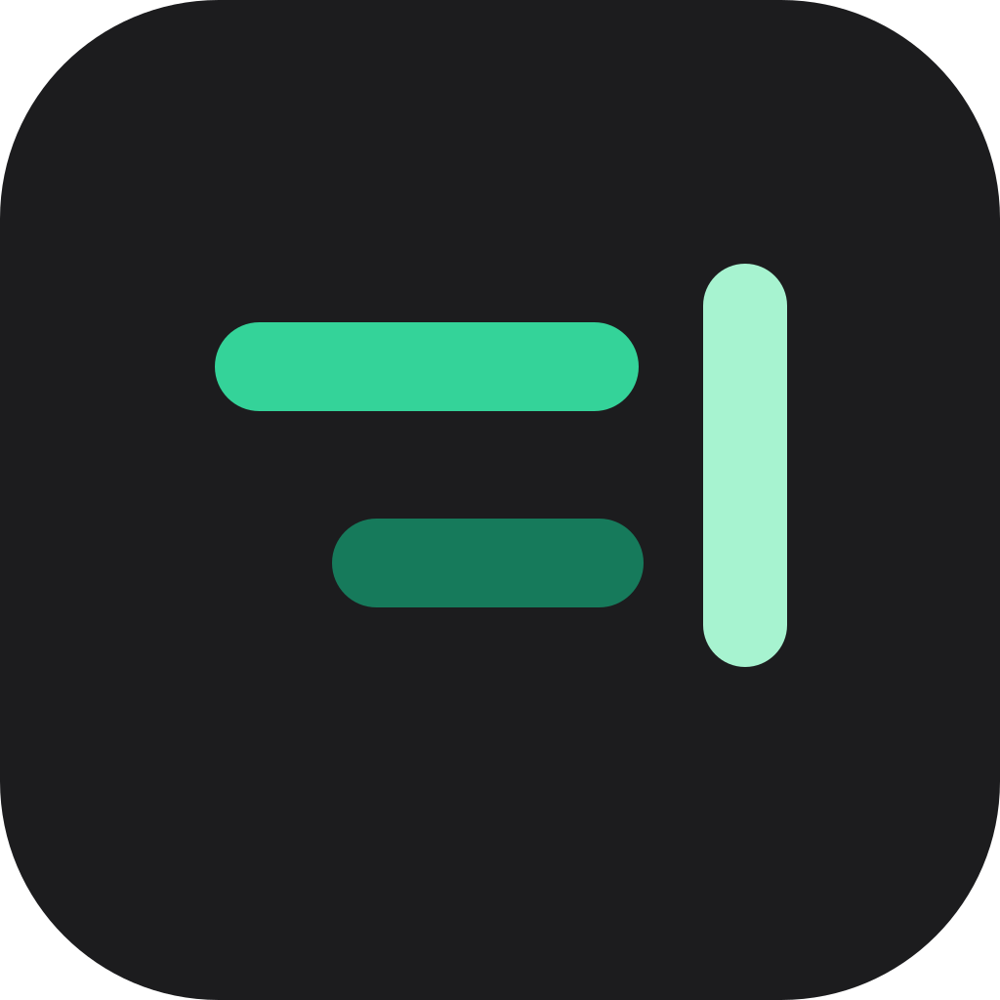
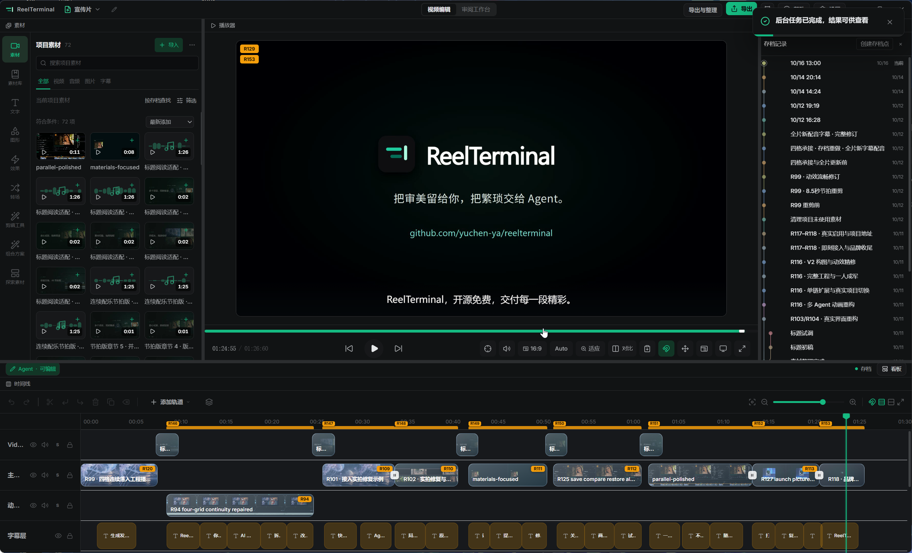
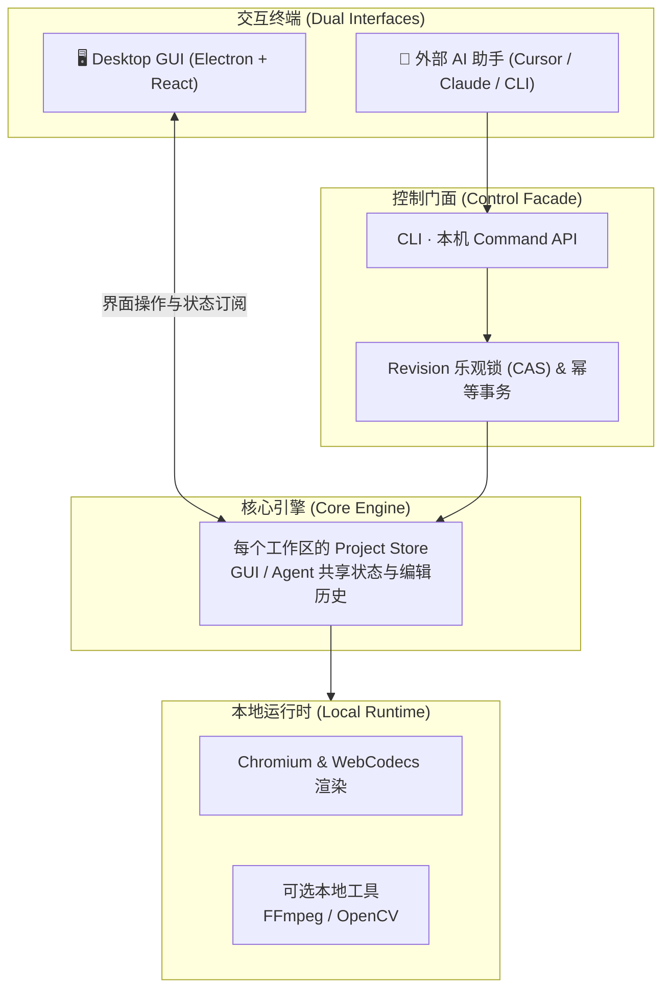

<div align="center">

[English](README_en.md) | **简体中文**



# ReelTerminal

### 面向 AI 视频生产的人机协同视频剪辑器
**生成发生在任何地方，成片交付在这里。**  
*Generate anywhere; finish here.*

<p align="center">
  <a href="https://github.com/yuchen-ya/reelterminal/releases"></a>
  <a href="docs/EXTERNAL-DEPENDENCIES.md"></a>
  <a href="apps/desktop/DISTRIBUTION.md#build"></a>
  <a href="https://github.com/yuchen-ya/reelterminal/issues"></a>
  <a href="LICENSE"></a>
</p>

[**🚀 快速开始**](#-快速开始-quick-start) • [**✨ 核心特点**](#-核心特点-core-features) • [**🏗️ 架构概览**](#-系统架构-architecture) • [**💬 交流与反馈**](#-交流与反馈-feedback) • [**📚 详细文档**](docs/)

</div>

---

## 💡 为什么做 ReelTerminal？

当下各类视频生成模型极大地降低了素材创作门槛，但在**碎片化的生成片段**与**最终想要的完整成片**之间，仍有很多繁琐的手工活：

* **素材零散**：几秒一段的视频、分批生成的配音、单独挑选的配乐散落各处，需要挑选版本、精准拼接、调速、转场和音画对位；拼起来后，还要处理音量落差、口播空白和配乐遮挡人声。
* **局部坏帧与瑕疵**：AI 生成的帧容易偶发闪烁、局部变形或伪影，若整段重新抽卡成本很高，更需要“定点修补”。
* **缺乏顺手的 AI 协同环境**：传统剪辑软件对大模型助手来说并不友好；而普通的脚本批处理又看不到画面、无法交互和撤销。

**ReelTerminal 试图提供一个平滑的折中解法：**  
保留现代剪辑器直观的画布和时间线，创作者可以在桌面端随手拖拽微调；同时让你的 AI 助手（Cursor、Claude、Antigravity 等）能直接操作工程时间线——**你主导创作和最终取舍，AI 负责批量与结构化处理；双方共享工程状态、编辑历史、版本存档和画面对比。**



*真实宣传片工程截图：保留便于人与 Agent 沟通的 R 片段引用标记，并展示素材库、多轨时间线和版本存档树。*

---

## ✨ 核心特点 (Core Features)

| 🤖 **面向 AI 助手协同设计** | 🎯 **逐帧审查与局部修补** |
| :--- | :--- |
| 为 AI 辅助剪辑定制了严谨的时间线接口，支持原子批处理、CAS 乐观锁与防重复提交，帮助 AI 助手可靠地执行复杂剪辑并检测冲突。内置双语操作手册供 Agent 按需检索，减少对界面操作的猜测。 | 使用 **0-based 解码帧索引** 与真实 PTS 时间戳定位画面，支持帧提取、接触表、区域补丁及对比。配置本地 OpenCV 后可使用光流跟踪与掩码工具。 |
| 🌿 **不可变版本节点与画面对比** | 🔒 **本地优先与受控素材存储** |
| 工作区保存与版本留存分开：保存当前编辑，或建立存档点用于只读预览、画面对比和后续采用。每个工作区保有独立状态，创作者决定是否采用 Agent 的试剪结果。 | 工程、素材缓存、编解码和渲染在本机处理，素材通过哈希引用与受控存储管理。模型、字体下载及可选在线服务按配置联网，外部 AI 助手由用户自行选择。 |

### 1.3.6：审阅导航与返工闭环

保留双侧栏布局，补齐单项侧栏定位、返工说明与完成反馈；集合支持 Markdown 摘要，处理记录默认前后对比，并修复视频对比句柄和详情缓存的释放。

审阅工作台支持父节点画板/分类模式和 Agent 预绑定的视频基准对比。项目模板保存本地完整项目快照，使用时新建独立项目；“探索更多素材”提供外部原站入口。另含媒体解码、最近项目、音频探测和桌面交互修复。1.3.3 停用新建任务分支，Agent 在同一任务中分组提交并更新条目版本；父节点按最新修改排序，文本接入开源 Markdown 阅读与编辑。1.3.4 为左侧任务卡片增加右键菜单，提供重命名、置顶、归档和删除入口。当前为本地 Windows x64 构建，验证和发布状态见[1.3.6 说明](docs/RELEASE-1.3.6.md)。

### 本地字幕与音频整理（1.2.5 引入）

* **在电脑上生成字幕**：选中有声音的视频或音频片段，打开本地字幕面板。默认使用 Qwen，也可选 SenseVoice，再由 Qwen 对齐到词级时间；支持自动识别语言或指定中文。生成后可修改文字，一次撤销整批字幕。
* **知道还缺什么环境**：设置中的环境检查会显示 Python、模型及音频工具是否就绪，并提供可复制给助手的配置说明。模型和 Python 环境需另行准备，安装包不附带模型，也不会自动运行 pip。本地字幕目前使用 CPU，长素材会分段处理；暂不支持倒放和变速曲线片段。
* **整理音量与停顿**：助手可以测量并统一响度、查找语音和静音区间、按分析结果剪去停顿或在说话时压低配乐，也可以按节拍位置切片。结果需要试听；分析不会自动改动时间线。
* **更多可选音频处理**：通过助手使用降噪、人声/伴奏分离、匿名说话人分组和多轨同步偏移估计。部分功能需要额外 Python 模型环境；说话人分组不是身份识别，同步估计也不是自动对齐保证。见[素材分析](docs/MATERIAL-ANALYSIS.md)。
* **更方便地交代任务**：协作指令可编辑、复用和从指令库选择，帮助助手了解当前任务。素材库历史在重开后保留；改善字幕语言处理、中文编码和安装包内 Python 工具的可用性。

先从一段短素材试起，检查字幕、试听音频，再处理完整工程。详细边界见[用户帮助](docs/USER-GUIDE.md)、[响度处理](docs/AUDIO-NORMALIZATION.md)和[外部依赖](docs/EXTERNAL-DEPENDENCIES.md)。

---

## 🚀 快速开始 (Quick Start)

### 方式一：直接使用（推荐 · 无需任何开发配置）


1. 前往 **[Releases 页面](https://github.com/yuchen-ya/reelterminal/releases)**，选择适合自己系统和架构的安装包。
2. 打开视频工程。需要助手修改工程时，在时间线上方将协作权限切换为 **`可编辑`**；可随时切回只读。
3. 在通知中点击 **「复制启动提示词」**，把内容发给具有本机 CLI 工具能力的 AI 助手。
4. 提示词包含本次安装的命令路径与协作规则。让助手确认目标工程、工作区和权限，再开始编辑；你继续在同一界面查看、调整和决定最终结果。

**1.3.6 当前构建目标为 Windows x64 安装版和便携 ZIP，尚未公开发布**。完整解压 ZIP 后运行 `ReelTerminal.exe`。Mac 用户可在[历史 v1.2.1](https://github.com/yuchen-ya/reelterminal/releases/tag/v1.2.1)找到此前的 Apple Silicon 包；它不是 1.3.6，本次未提供新的 Mac 包。

**旧版用户请先看[Windows 升级与备份](docs/WINDOWS-UPGRADE.md)。** 旧危险安装不能直接覆盖升级，也不要先运行旧卸载器。先备份并退出旧版，优先将新 ZIP 解压到全新目录使用，保留旧目录；安装版迁移需按指引处理。Windows 包未签名，可能出现未知发布者或 SmartScreen 提示；只从本项目下载并核对 SHA-256，不关闭系统安全设置。

**源码与安装包分别维护。** 本页介绍当前仓库的功能与用法；下载包包含的功能、修复和使用限制以对应 Release 说明为准，源码更新不会自动更新已安装应用。

原生导出成功后才替换目标文件，取消或失败会保留已有文件。使用项目模板会新建独立项目，保留当前工程与历史；模板不是独立打包所有媒体的备份。检查器中的 3D 属性修改不单独记录撤销步骤，重要阶段可保留存档点。大工程和长时间编辑可能占用较多内存。

部分导出、媒体分析和逐帧工具需要本机可用的 FFmpeg/ffprobe；OpenCV 工具另需含 `cv2`、`numpy` 的 Python。依赖和联网行为见[外部依赖说明](docs/EXTERNAL-DEPENDENCIES.md)。

---

### 方式二：开发者源码构建与启动

使用 Node.js 22.13.0 或更新版本，以及仓库固定的 pnpm 11.7.0。示例先启用 Corepack，确保构建脚本也能找到 `pnpm` 命令：

```bash
git clone https://github.com/yuchen-ya/reelterminal.git
cd reelterminal

corepack enable
corepack pnpm install --frozen-lockfile
corepack pnpm build:wasm
corepack pnpm --filter @reelterminal/desktop build
corepack pnpm --filter @reelterminal/desktop start

# 可选：启动浏览器开发服务器
corepack pnpm dev
```

开发检查和可选工具配置见 [CONTRIBUTING.md](CONTRIBUTING.md)，打包命令见[桌面构建说明](apps/desktop/DISTRIBUTION.md#build)。

---

## 🏗️ 系统架构 (Architecture)



---

## 💬 交流与反馈 (Feedback)

ReelTerminal 面向需要整理、修补并交付 AI 视频的创作者，由独立开发者维护。欢迎反馈真实创作中的问题和需求。

可以通过 Issues 反馈：

- 遇到了 bug 或奇怪的交互体验？
- 有某个剪辑工作流特别希望得到支持？
- 对时间线或 AI 协作交互有更好的想法？

欢迎在 **[GitHub Issues](https://github.com/yuchen-ya/reelterminal/issues)** 附上操作步骤和必要的脱敏信息；安全问题请使用 [SECURITY.md](SECURITY.md) 中的私密报告渠道。

---

## 📚 详细文档 (Documentations)

使用指南、开发说明与发行信息：

- 📖 [**桌面端用户手册**](docs/USER-GUIDE.md) — 桌面端安装、界面导览与常用操作。
- 🌿 [**多项目与版本节点指南**](docs/MULTI-PROJECT-USAGE.md) — 紧凑版本轨道、保存与留存分离（Save vs Retain）、只读预览与画面对比。
- 📐 [**版本节点交互规范**](docs/VERSION-NODES-UX.md) — 存档树、采用（Adopt）、回收与冲突保护设计准则。
- 🤖 [**外部 Agent 协作指南**](docs/AGENT-GUIDE.md) — 权限机制、CLI 详解与进阶接口。
- 🗂️ [**任务工作区规程**](docs/AGENT-WORKSPACE.md) — 独立工作目录规程与落盘准则。
- ⚙️ [**Command API 规范**](docs/COMMAND-API.md) — 命令目录、Schema 校验与并发控制。
- 🎞️ [**媒体审查与修复流**](docs/MEDIA-REVIEW-WORKFLOWS.md) — 逐帧提取、接触表与光流运动追踪。
- 🎨 [**色彩管理白皮书 (SDR)**](docs/COLOR.md) — BT.709 与 BT.601 颜色转换规范。
- 🌐 [**外部依赖与联网行为**](docs/EXTERNAL-DEPENDENCIES.md) — 本地工具、资源下载及可选在线服务。
- 📦 [**发行与更新说明**](https://github.com/yuchen-ya/reelterminal/releases) — 安装包、修复范围、签名与校验信息。

---

## ⚖️ 开源协议与鸣谢 (License & Attribution)

* 本项目核心代码基于 [MIT License](LICENSE) 开源发布。
* 本项目继承并改造自 Augustus Otu 及贡献者开源的 MIT 协议项目 [OpenReel](https://github.com/Augustus-Otu/openreel)，原始版权声明予以完整保留。
* 第三方组件、字体与模型授权审查详情请参阅 [THIRD_PARTY_NOTICES.md](THIRD_PARTY_NOTICES.md)。
