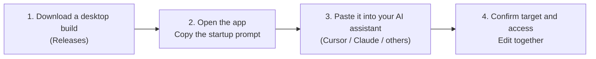
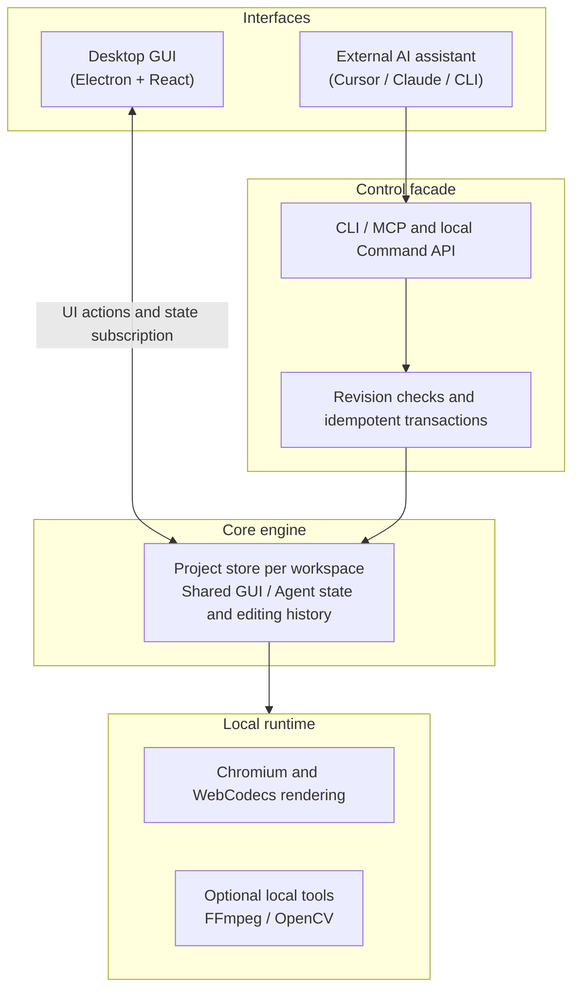

<div align="center">

**English** | [简体中文](README.md)


# ReelTerminal

### A collaborative video editor for people and AI assistants
**Generate anywhere; finish here.**

<p align="center">
  <a href="https://github.com/yuchen-ya/reelterminal/releases"></a>
  <a href="docs/EXTERNAL-DEPENDENCIES.md"></a>
  <a href="apps/desktop/DISTRIBUTION.md#build"></a>
  <a href="https://github.com/yuchen-ya/reelterminal/issues"></a>
  <a href="LICENSE"></a>
</p>

[**🚀 Quick start**](#-quick-start) • [**✨ Core features**](#-core-features) • [**🏗️ Architecture**](#-architecture) • [**💬 Feedback**](#-feedback) • [**📚 Documentation**](docs/)

</div>

---

## 💡 Why ReelTerminal?

AI video models make it easier to create footage, but turning **a collection of generated clips** into **a finished video** still takes a lot of manual work:

* **Scattered footage:** short generated clips need precise cuts, timing adjustments, transitions, and audio alignment.
* **Bad frames and artifacts:** flicker, distorted shapes, and other defects often affect only a small part of a clip. Repairing that section can be more practical than generating the whole shot again.
* **Awkward AI collaboration:** traditional editors are difficult for an AI assistant to operate, while batch scripts offer little visual feedback, interaction, or undo.

**ReelTerminal brings a visual editor and an assistant-friendly timeline together.** Drag and adjust clips in the desktop app, or let your AI assistant—Cursor, Claude, Antigravity, and others—operate the same project. **You lead the creative decisions; the assistant handles repetitive and structured edits. Both work with shared project state, editing history, version archives, and player comparison.**


*A real promotional-video project in the Chinese interface, with R clip reference markers used for human–Agent communication, the media library, multitrack timeline, and version archive tree.*

---

## ✨ Core features

| 🤖 **Designed for AI collaboration** | 🎯 **Frame review and local repair** |
| :--- | :--- |
| A structured timeline API supports atomic batches, revision checks, and duplicate-request protection, helping assistants apply edits without conflicting with ongoing work. A built-in bilingual manual answers UI how-to queries on demand, reducing guesswork about interface operations. | Uses **zero-based decoded frame indexes** and actual presentation timestamps to locate footage, with frame extraction, contact sheets, region patches, and comparison. A configured local OpenCV runtime enables optical-flow and mask tools. |
| 🌿 **Immutable version nodes & comparison** | 🔒 **Local-first media storage** |
| Save the current workspace or retain a version node for read-only preview, comparison, and adoption. Each workspace has independent state; the creator decides whether to adopt an assistant’s trial edit. | Projects, media caches, decoding, and rendering are processed locally. Hash references and controlled storage manage media. Model/font downloads and optional online services use the network as configured; external AI assistants are chosen by the user. |

---

## 🚀 Quick start

### Option 1: Use the desktop app



1. Visit **[Releases](https://github.com/yuchen-ya/reelterminal/releases)** and choose a build for your operating system and architecture.
2. Open a video project. When you want the assistant to modify it, switch collaboration above the timeline to **`Editable`**; you can return to read-only access at any time.
3. Click **“Copy startup prompt”** in the notification and send it to an AI assistant with local CLI or MCP tool access.
4. The prompt includes this installation’s command paths and collaboration rules. Have the assistant confirm the intended project, workspace, and permissions before editing. Continue reviewing, adjusting, and making creative decisions in the same UI.

Current downloads include a **Windows x64 installer/portable ZIP** and **macOS Apple Silicon (arm64) DMG/ZIP**. Check [Releases](https://github.com/yuchen-ya/reelterminal/releases) for exact assets, architectures, signing, and checksums. Extract the entire Windows ZIP before running `ReelTerminal.exe`. Windows packages are not code-signed and may show an unknown-publisher warning. Mac packages lack Developer ID signing and notarization, so the system may prevent them from opening directly.

**Source and installed packages are maintained separately.** This page describes the current repository’s capabilities and usage. Check the corresponding Release for a download’s features, fixes, and limitations; updating source does not update an installed app.

With published packages, export native video to a new filename and verify it before replacing an existing file. Keep a project copy before applying a whole-project template, and avoid replaying pre-replacement undo/redo afterward. 3D property changes are not recorded as separate undo steps; retain version nodes for important stages. Large projects and long editing sessions can use substantial memory.

Some export, media-analysis, and frame tools need local FFmpeg/ffprobe. OpenCV tools also need Python with `cv2` and `numpy`. See [external dependencies](docs/EXTERNAL-DEPENDENCIES.md) for tool requirements and network behavior.

---

### Option 2: Build from source

Use Node.js 22.13.0 or newer and the repository-pinned pnpm 11.7.0. The examples invoke pnpm through Corepack:

```bash
# 1. Clone the repository
git clone https://github.com/yuchen-ya/reelterminal.git
cd reelterminal

# 2. Install dependencies and build the WASM modules
corepack pnpm install --frozen-lockfile
corepack pnpm build:wasm

# 3. Build and start the desktop app
corepack pnpm --filter @reelterminal/desktop build
corepack pnpm --filter @reelterminal/desktop start

# Alternatively, start the web editor with: corepack pnpm dev
```

See [CONTRIBUTING.md](CONTRIBUTING.md) for development checks and optional tool setup, and [desktop distribution](apps/desktop/DISTRIBUTION.md#build) for packaging instructions.

---

## 🏗️ Architecture



---

## 💬 Feedback

ReelTerminal is independently developed for creators organizing, repairing, and delivering AI video. Feedback from real editing workflows helps guide the project.

Use Issues to share:

* Found a bug or an awkward interaction?
* Have an editing workflow you would like supported?
* Have ideas for the timeline or collaboration with an AI assistant?

Please share them through **[GitHub Issues](https://github.com/yuchen-ya/reelterminal/issues)**. Reports in English are welcome, and I read every one. For security vulnerabilities, use the private reporting route in [SECURITY.md](SECURITY.md).

---

## 📚 Documentation

Some guides are currently in Chinese; command names and code examples are shared across both interfaces.

* 📖 [**Desktop user guide**](docs/USER-GUIDE.md) — installation, interface tour, and common operations. Desktop builds include English and Chinese offline manuals.
* 🌿 [**Multi-project & version nodes guide**](docs/MULTI-PROJECT-USAGE.md) — compact version track, save-versus-retain workflows, read-only preview, and comparison.
* 📐 [**Version nodes UX specification**](docs/VERSION-NODES-UX.md) — save-point tree, branch adoption, recycling, and conflict rules.
* 🤖 [**External Agent guide**](docs/AGENT-GUIDE.md) — access modes, CLI usage, and advanced commands.
* 🗂️ [**Agent workspace guide**](docs/AGENT-WORKSPACE.md) — task directories and output-file conventions.
* ⚙️ [**Command API specification**](docs/COMMAND-API.md) — commands, schema validation, and concurrency control.
* 🎞️ [**Media review and repair workflows**](docs/MEDIA-REVIEW-WORKFLOWS.md) — frame extraction, contact sheets, and optical-flow tracking.
* 🎨 [**SDR color management**](docs/COLOR.md) — BT.709 and BT.601 color conversion.
* 🌐 [**External dependencies**](docs/EXTERNAL-DEPENDENCIES.md) — local tools, resource downloads, and optional network integrations.
* 📦 [**Release information**](https://github.com/yuchen-ya/reelterminal/releases) — packages, included fixes, signing, and checksums.

---

## ⚖️ License and attribution

* The project's core code is available under the [MIT License](LICENSE).
* ReelTerminal builds on the MIT-licensed [OpenReel](https://github.com/Augustus-Otu/openreel) project by Augustus Otu and contributors. The original copyright notice is preserved.
* Separately licensed components, fonts, and model resources are documented in [THIRD_PARTY_NOTICES.md](THIRD_PARTY_NOTICES.md).
