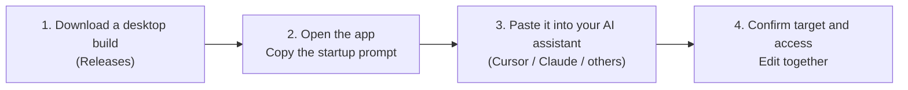
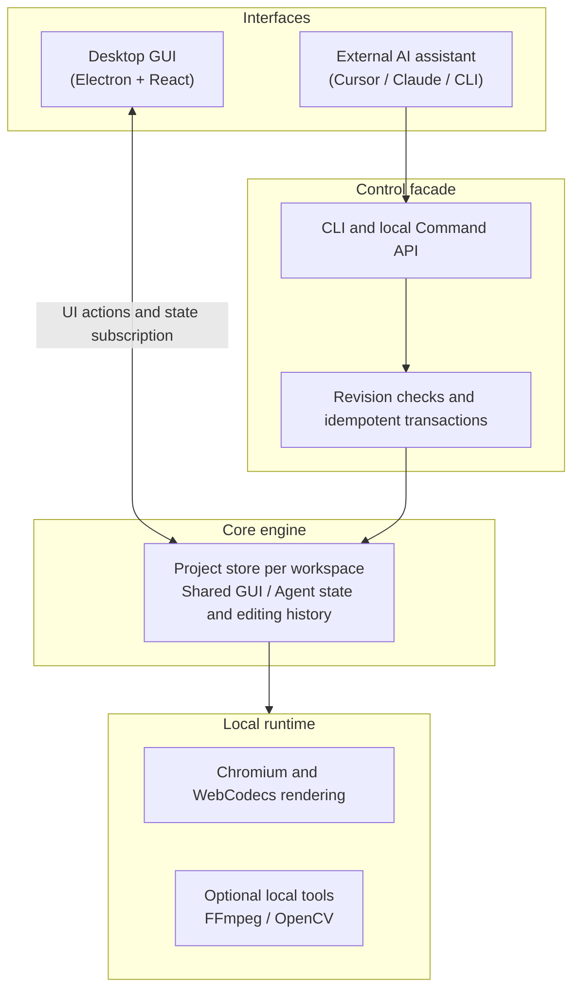

<div align="center">

**English** | [简体中文](README.md)


# ReelTerminal

### A collaborative video editor for people and AI assistants
**Generate anywhere; finish here.**

<p align="center">
  <a href="https://github.com/yuchen-ya/reelterminal/releases"></a>
  <a href="docs/EXTERNAL-DEPENDENCIES.md"></a>
  <a href="apps/desktop/DISTRIBUTION.md#build"></a>
  <a href="https://github.com/yuchen-ya/reelterminal/issues"></a>
  <a href="LICENSE"></a>
</p>

[**🚀 Quick start**](#-quick-start) • [**✨ Core features**](#-core-features) • [**🤖 For AI Agents**](#-for-ai-agents) • [**🏗️ Architecture**](#-architecture) • [**📚 Documentation**](#-documentation)

</div>

---

## 💡 Why ReelTerminal?

AI video models make it easier to create footage, but turning **a collection of generated clips** into **a finished video** still takes a lot of manual work:

* **Scattered media:** short video clips, separately generated voiceovers, and music selections arrive in different batches. Choosing takes, cutting, retiming, adding transitions, and aligning sound still leave uneven loudness, long pauses, and music competing with speech to resolve.
* **Bad frames and artifacts:** flicker, distorted shapes, and other defects often affect only a small part of a clip. Repairing that section can be more practical than generating the whole shot again.
* **Awkward AI collaboration:** traditional editors are difficult for an AI assistant to operate, while batch scripts offer little visual feedback, interaction, or undo.

**ReelTerminal brings a visual editor and an assistant-friendly timeline together.** Drag and adjust clips in the desktop app, or let your AI assistant—Cursor, Claude, Antigravity, and others—operate the same project. **You lead the creative decisions; the assistant handles repetitive and structured edits. Both work with shared project state, editing history, version archives, and player comparison.**


*A real promotional-video project in the Chinese interface, with R clip reference markers used for human–Agent communication, the media library, multitrack timeline, and version archive tree.*

---

## ✨ Core features

| 🤖 **Designed for AI collaboration** | 🎯 **Frame review and local repair** |
| :--- | :--- |
| A structured timeline API supports atomic batches, revision checks, and duplicate-request protection, helping assistants apply edits without conflicting with ongoing work. A built-in bilingual manual answers UI how-to queries on demand, reducing guesswork about interface operations. | Uses **zero-based decoded frame indexes** and actual presentation timestamps to locate footage, with frame extraction, contact sheets, region patches, and comparison. A configured local OpenCV runtime enables optical-flow and mask tools. |
| 🌿 **Immutable version nodes & comparison** | 🔒 **Local-first media storage** |
| Save the current workspace or retain a version node for read-only preview, comparison, and adoption. Each workspace has independent state; the creator decides whether to adopt an assistant’s trial edit. | Projects, media caches, decoding, and rendering are processed locally. Hash references and controlled storage manage media. Model/font downloads and optional online services use the network as configured; external AI assistants are chosen by the user. |

### 🆕 What's new in v1.3.6

- **Project templates and media management:** save local project snapshots as templates to spin up independent projects (referenced source media and fonts must remain available); trace external assets back to their original sites from the media panel, and manage artifact ownership and reviewed export cleanup.
- **Decoding and desktop stability:** improved video decoding, frame resource cleanup, audio environment probing, and native render timeout control; strengthened export validation and target-file protection (replacing target files only after a successful export) while preserving temporarily offline recent projects.
- **Review workspace (iterating):** added a batch review and Agent rework workspace for images, text, and video. Designed around personal workflow preferences and currently under active iteration.

See the [1.3.6 build notes](docs/RELEASE-1.3.6.md) and [Releases](https://github.com/yuchen-ya/reelterminal/releases) for full details.

### 🎙️ Local captions and audio cleanup

- **On-device caption generation:** generate word-aligned captions locally using Qwen (default) or SenseVoice + Qwen alignment, with automatic language detection or explicit Chinese mode. Edit generated captions in place or undo an entire batch in one step.
- **Quantitative audio analysis and cleanup:** assistants can measure and normalize loudness (LUFS), detect speech (VAD) and silence intervals, cut pauses, duck background music under dialogue, or snap cuts to detected beats. Optional tools support denoising, vocal/instrumental separation, anonymous speaker clustering, and multitrack sync-offset estimation. Analysis commands only produce structured records—timeline edits always require explicit editing commands.
- **Environment checks and reusable instructions:** the built-in environment panel in Settings checks Python, model, and audio tool readiness with one-click setup instructions for your assistant. Save and reuse common collaboration prompts from the instruction library.

> 💡 **Tip:** Desktop installers do not bundle large models or run `pip` automatically. Start with a short test clip to verify captions and audio results before processing a full project. See the [user guide](docs/USER-GUIDE.md), [material analysis](docs/MATERIAL-ANALYSIS.md), and [loudness normalization](docs/AUDIO-NORMALIZATION.md) for detailed boundaries.

---

## 🚀 Quick start

### Option 1: Use the desktop app (Recommended)



1. Visit **[Releases](https://github.com/yuchen-ya/reelterminal/releases)** and download the package for your system.
2. Open a video project. When you want your AI assistant to modify the timeline, switch collaboration access above the timeline from read-only to **`Editable`** (you can switch back at any time).
3. Click **“Copy startup prompt”** in the notification and send it to an AI assistant with local CLI access.
4. The assistant uses the prompt's command paths to inspect project context, confirm the target project and workspace with you, and apply edits while you review, fine-tune, and compare versions in the same UI.

#### Installation and upgrade notes

- **Platform availability:** v1.3.6 provides a **Windows x64** installer and portable ZIP (extract the entire archive before running `ReelTerminal.exe`). macOS Apple Silicon users can use the earlier [v1.2.1](https://github.com/yuchen-ya/reelterminal/releases/tag/v1.2.1) build (does not include 1.3.6 changes).
- **Upgrading and security:** existing Windows users should read [Windows upgrade and backup](docs/WINDOWS-UPGRADE.md#english) before upgrading—back up first and prefer extracting the new portable ZIP into a fresh directory. Windows builds may be unsigned; if SmartScreen appears, verify that the download came from official Releases and check its SHA-256 checksum.
- **Optional local tools:** some export, media-analysis, and optical-flow repair tools require local `FFmpeg/ffprobe` or Python with `cv2` and `numpy`. See [external dependencies](docs/EXTERNAL-DEPENDENCIES.md) for details.

---

### Option 2: Build from source

Use Node.js 22.13.0 or newer and the repository-pinned pnpm 11.7.0. Enable Corepack so that the `pnpm` command is also available to build scripts:

```bash
# 1. Clone the repository
git clone https://github.com/yuchen-ya/reelterminal.git
cd reelterminal

# 2. Install dependencies and build the WASM modules
corepack enable
corepack pnpm install --frozen-lockfile
corepack pnpm build:wasm

# 3. Build and start the desktop app
corepack pnpm --filter @reelterminal/desktop build
corepack pnpm --filter @reelterminal/desktop start

# Alternatively, start the web editor with: corepack pnpm dev
```

See [CONTRIBUTING.md](CONTRIBUTING.md) for development checks and optional tool setup, and [desktop distribution](apps/desktop/DISTRIBUTION.md#build) for packaging instructions.

---

## 🤖 For AI Agents

If you are an AI assistant (Claude, Cursor, Antigravity, Codex, etc.) reading this repository, select the workflow and contract matching your task:

| Task scenario | Primary references | Core execution contracts |
| :--- | :--- | :--- |
| **🎬 Video editing & production**<br>(Collaborating on a live desktop project) | • [External Agent guide](docs/AGENT-GUIDE.md)<br>• [Agent workspace guide](docs/AGENT-WORKSPACE.md)<br>• [Command API spec](docs/COMMAND-API.md) | 1. **Connection & auth:** inspect state via `reelctl status` and `reelctl context --compact`. Never print or log `live-endpoint.json` or its token. Ask the user to enable `Editable` mode if write access is required.<br>2. **Explicit target binding:** bind reads and edits to explicit `projectId`, `workspaceId`, and `expectedRevision` guards; never silently retarget when GUI selection changes.<br>3. **Workspace isolation:** query `reelctl call capabilities.get` for `mediaImport.recommendedRoot` and place all generated media, frames, and helper scripts under `jobs/<YYYY-MM-DD>-<slug>/`—**never inside the source tree**. |
| **🛠️ Repository development & testing**<br>(Code edits, bug fixes, builds) | • [Agent rules (AGENTS.md)](AGENTS.md)<br>• [Contributing guide](CONTRIBUTING.md)<br>• [Desktop E2E harness](apps/desktop/e2e/README.md) | 1. **Do not probe user instances:** source edits, unit tests, and builds do not require connecting to a live desktop app. Use the isolated harness in `apps/desktop/e2e` for GUI regressions.<br>2. **History & state boundaries:** whole-project replacement must go through `ProjectState.loadProject`; persisted edits must use the store's recorded commit boundary (`ActionHistory.nextSequence`), reserving `rawSet` for replay/recovery/transient previews.<br>3. **Single checkout:** do not create extra Git worktrees without an explicit request; inspect `git status` first and preserve existing uncommitted work. |

> 📌 **Key state boundaries:**
> - **Analysis vs. timeline edits:** loudness measurement, VAD, silence detection, and beat detection only create analysis records; explicit editing commands (e.g., `clip.cutSilenceFromAnalysis`, `clip.setDuckingFromAnalysis`) are required to modify the timeline.
> - **Undo & templates:** Inspector 3D property adjustments are not recorded as individual undo steps—retain a version node before major experiments. Project templates store structural snapshots and do not bundle source media files as a standalone backup.

---

## 🏗️ Architecture



---

## 💬 Feedback

ReelTerminal is independently developed for creators organizing, repairing, and delivering AI video. Feedback from real editing workflows helps guide the project.

Use Issues to share:

* Found a bug or an awkward interaction?
* Have an editing workflow you would like supported?
* Have ideas for the timeline or collaboration with an AI assistant?

Please share them through **[GitHub Issues](https://github.com/yuchen-ya/reelterminal/issues)**. Reports in English are welcome, and I read every one. For security vulnerabilities, use the private reporting route in [SECURITY.md](SECURITY.md).

---

## 📚 Documentation

Some guides are currently in Chinese; command names and code examples are shared across both interfaces.

* 📖 [**Desktop user guide**](docs/USER-GUIDE.md) — installation, interface tour, and common operations. Desktop builds include English and Chinese offline manuals.
* 🌿 [**Multi-project & version nodes guide**](docs/MULTI-PROJECT-USAGE.md) — compact version track, save-versus-retain workflows, read-only preview, and comparison.
* 📐 [**Version nodes UX specification**](docs/VERSION-NODES-UX.md) — save-point tree, branch adoption, recycling, and conflict rules.
* 🤖 [**External Agent guide**](docs/AGENT-GUIDE.md) — access modes, CLI usage, and advanced commands.
* 🗂️ [**Agent workspace guide**](docs/AGENT-WORKSPACE.md) — task directories and output-file conventions.
* ⚙️ [**Command API specification**](docs/COMMAND-API.md) — commands, schema validation, and concurrency control.
* 🎞️ [**Media review and repair workflows**](docs/MEDIA-REVIEW-WORKFLOWS.md) — frame extraction, contact sheets, and optical-flow tracking.
* 🎨 [**SDR color management**](docs/COLOR.md) — BT.709 and BT.601 color conversion.
* 🌐 [**External dependencies**](docs/EXTERNAL-DEPENDENCIES.md) — local tools, resource downloads, and optional network integrations.
* 📦 [**Release information**](https://github.com/yuchen-ya/reelterminal/releases) — packages, included fixes, signing, and checksums.

---

## ⚖️ License and attribution

* The project's core code is available under the [MIT License](LICENSE).
* ReelTerminal builds on the MIT-licensed [OpenReel](https://github.com/Augustus-Otu/openreel) project by Augustus Otu and contributors. The original copyright notice is preserved.
* Separately licensed components, fonts, and model resources are documented in [THIRD_PARTY_NOTICES.md](THIRD_PARTY_NOTICES.md).
