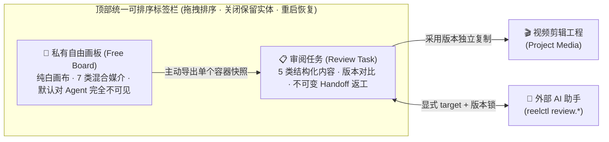

<div align="center">

[← 视频剪辑器主页](README.md) &nbsp;·&nbsp; **🧪 审阅工作台 (简体中文)** | [English](README_review_en.md)

# ReelTerminal · 审阅工作台与私有自由画板
### 面向 AI 多模态半成品的批次筛选、像素修补、人机交接与混合媒介草图空间

[**💡 为什么做审阅工作台**](#-为什么做审阅工作台) • [**🗂️ 核心工作区与隐私边界**](#️-核心工作区与隐私边界) • [**🎨 私有自由画板**](#-私有自由画板-free-boards) • [**🤖 Agent 接入与 CLI**](#-面向-ai-agent-的审阅与修补-cli) • [**📚 详细文档**](#-详细文档)

</div>

> [!IMPORTANT]
> **实验性模块声明（Experimental）**  
> 审阅工作台与自由画板无需创建或打开视频剪辑工程即可独立运行。该模块围绕个人 AI 素材抽卡、批次筛选、局部修补与多轮 Agent 返工偏好定制，当前处于持续高频迭代阶段，界面交互与命令细节可能随实际生产需求演进。

---

## 💡 为什么做审阅工作台？

在生成的素材真正进入视频时间线之前，往往存在大量**上游半成品筛选与返工**工作：

* **多模态批次杂乱**：一次抽卡或脚本跑批可能同时产出几十张候选图、分镜序列、Markdown 语料、清洗表格、视频片段甚至 3D GLB 模型，直接在文件夹或聊天窗口里比对极易迷失版本。
* **局部瑕疵只需定点修补**：单张图片局部崩坏或视频某几帧穿帮时，往往只需要圈注问题、涂抹修补或准确抽出单帧修复，而不必整批重跑。
* **草稿思考与正式交接需要隔离**：创作者需要一块绝对私密、不被 AI 助手自动窥探或打扰的白板来自由拼贴灵感；同时又需要在确认无误后，将明确的返工指令与像素级快照原子化地交接给 Agent。

---

## 🗂️ 核心工作区与隐私边界

自 v1.3.9 起，审阅工作台采用**顶部统一可排序标签栏（Workspace Tabs）**，将「审阅任务」与「私有自由画板」融合在同一套标签体验中，同时在底层保持严格的权限与可见性隔离：



- **统一标签与管理**：审阅任务和自由画板可在同一标签栏自由混排、拖拽调整顺序；关闭标签仅收起视图而不删除数据，重启应用自动恢复标签顺序与激活项。点击标签栏的「打开 / 管理」对话框可集中管理任务分类、归档、回收站与画板列表。
- **地址栏单行上下文**：切换到审阅任务时，顶部地址栏提供该任务的显式 `start --target <ref>` 命令一键复制；切换到私有自由画板时，地址栏明确提示当前为私有空间、不暴露 Agent 目标。

---

## 📋 审阅任务 (Review Tasks)

审阅任务面向**结构化批次决策与人机闭环返工**，每个任务代表一个独立目标，Agent 在指定任务内持续提交批次或版本更新，不因返工或试做拆散为多个任务：

| 能力维度 | 核心特性与边界 |
| :--- | :--- |
| **5 类正式内容** | • **图片 (`image`)**：自适应画板或分类目录浏览、整数倍像素放大、圈注与源像素修补。<br>• **文本 (`text`)**：默认 Markdown 排版阅读，支持轻量实时预览编辑与原文精确字符区间批注，保存生成新版本。<br>• **结构化数据 (`data`)**：表格行列浏览、原值与建议值对照、单元格级修改与显式返工徽标。<br>• **视频 (`video`)**：真实浏览器时间轴播放、区间标记、预绑定同批基准视频并排或叠画对比。<br>• **3D 模型 (`model3d`)**：自包含 GLB 2.0 三角网格（PBR/骨骼/形变动画）轻量只读预览、双视图对照与相机视角截图反馈。 |
| **定点修补与准确截帧** | • **像素修补与草稿**：内置画笔、独立透明修补层橡皮、仿制图章与贴片；支持 CLI 区域检查、多步未保存草稿预览（`review.repair.draft.*`）及单版本原子提交。<br>• **视频准确截帧**：`review.frames.capture` 按 **0-based 解码帧索引 + 真实源 PTS** 从视频条目抽出准确帧并在同任务创建关联图片条目，无缝衔接后续像素修补。<br>• **连续更新不闪屏**：CLI 连续提交修补版本时保留已解码画面、缩放视口与焦点；首张修补图若解码失败自动回退显示原图并披露真实原因。 |
| **不可变交接 (Handoff) 与过程追溯** | • **草稿隔离**：保留、丢弃、返工均可撤销；未发布的草稿批注绝不进入 Agent 读取通道。<br>• **显式交接**：点击「交回本轮决策」发布不可变快照，等待 Agent 真实读取确认并按条目版本 + 决策修订号绑定返工。<br>• **处理过程与命令日志**：「处理过程」展示真实记录的输入、输出、参数与候选分支，可固定任意两个版本比对或导出；界面底部展示目标隔离的真实 CLI 活动记录（自动脱敏敏感字段）。 |
| **多粒度导出与入库** | • 支持条目或分组直接原生拖出到系统资源管理器，或通过导出对话框导出初始原件、当前保存版、人工采用版及含完整历史的节点包（`.zip`/文件夹）。<br>• 「添加采用版本到项目」可将人工采用的图片或视频独立复制到指定视频工程与工作区的媒体库（不自动改动时间线）。 |

---

## 🎨 私有自由画板 (Free Boards)

自由画板基于 **Excalidraw（固定 `#FFFFFF` 纯白背景）** 构建，是创作者的**私密混合媒介草图本**：

- **7 类混合媒介同板排布**：
  - 直接拖入或粘贴**图片、文本（`.txt`/`.log`）、视频、3D GLB、Markdown（`.md`）、本地 HTML（`.html`/`.htm`）**，或粘贴单独的 **HTTP/S 链接**生成网页容器。
  - 视频容器支持播放定位与「截取当前帧」入板；GLB 容器支持旋转缩放与「截取当前视角」入板；图片支持裁剪、90° 旋转、翻转与源像素修补（画笔/橡皮/仿制图章/外部贴片）。
- **受管文档与隔离原生浏览**：
  - Markdown 导入仅保留文档目录内实际引用的受管本地资源，支持源码编辑与相对链接打开新容器。
  - 本地 HTML 自动通过隔离 Chromium 视图生成首屏快照（仅加载本地受管资产，不访问外网）；网页容器默认仅展示 URL，点击「进入浏览」才在固定区域启动无 Node/preload 权限的原生 Chromium 视图，随时可「截图当前视口并返回画板」。
- **区域冻结 PNG 与单文件输出**：
  - 「区域截图」基于源图片像素、矢量标注、3D 1920px 重渲染及文档已保存视口生成高分辨率白底 PNG，支持一键**拖出文件、复制到剪贴板、保存到本地或作为新图加入画板**。
- **🔒 严格的 Agent 隔离契约**：
  - 自由画板独立存储，**默认不创建审阅节点，也不进入 Agent 上下文、变更列表、Handoff 或审阅修补 CLI**。
  - 只有当你选中单个容器并主动点击 **「导出此内容为审阅节点」** 时，系统才会将该容器的当前快照生成为一个正式审阅节点供后续审阅或协同。

详细操作请参阅 📖 **[自由画板使用说明 (docs/HUMAN-BOARDS.zh-CN.md)](docs/HUMAN-BOARDS.zh-CN.md)**。

---

## 🤖 面向 AI Agent 的审阅与修补 CLI

审阅工作台拥有**独立于视频工程的 Agent 写权限开关**（位于审阅工作台顶部栏）。即使未打开任何视频项目，外部 AI 助手也可通过 `reelctl` 连接审阅工作台：

```powershell
# 1. 运行从当前审阅任务地址栏复制的启动命令（绑定显式 review target，不含凭据）
reelctl start --target <rt1-review-ref>

# 2. 按需发现审阅能力包与命令 Schema（轻量无环境探测）
reelctl tools review
reelctl tools review.content
reelctl tools review.image-repair
reelctl describe review.ingest
reelctl describe review.repair.draft.apply

# 3. 从视频条目按 0-based 解码帧索引准确截帧为可修补图片条目
reelctl review frames capture --file exact-frame.json

# 4. 像素区域检查 → 创建多步修补草稿预览 → 确认后单版本原子提交
reelctl review repair inspect --file inspect-region.json
reelctl call review.repair.draft.create --file draft-create.json
reelctl call review.repair.draft.apply --file draft-ops.json
reelctl call review.repair.draft.inspect --file draft-inspect.json
reelctl call review.repair.draft.commit --file draft-commit.json
```

> 📌 **核心执行契约**：
> - **固定目标绑定**：所有读写命令必须携带显式 `target`（`reviewWorkspaceId`、`instanceId`、`nodeId`）与版本锁（`expectedNodeRevision` / `expectedItemVersion`），绝不因 GUI 切换到其他标签页或自由画板而静默改变操作目标。
> - **单任务内持续演进**：同一目标的新批次使用 `review.ingest`，条目整版替换使用 `review.items.submit`，局部像素修补使用 `review.repair.*`，切勿为返工或候选分支擅自新建审阅任务。

---

## 📚 详细文档

- 🎨 [**自由画板使用说明**](docs/HUMAN-BOARDS.zh-CN.md) — 7 类媒介导入、Markdown/HTML/网页浏览、像素修补、区域冻结 PNG 与主动导出快照。
- ⚙️ [**Command API · 独立审阅工作台规范**](docs/COMMAND-API.md#independent-review-workspace) — `review.*` 命令族、`review.repair.*` / `draft.*` 像素修补协议与 `review.frames.capture` 准确截帧契约。
- 🧊 [**审阅 3D (GLB) 轻量预览说明**](docs/REVIEW-3D-PREVIEW-DELIVERY.md) — GLB 2.0 准入边界、资源门限、双视图比较与视角截图反馈结构。
- 📖 [**桌面端用户手册 · 审阅工作台章节**](docs/USER-GUIDE.md#审阅工作台) — 界面交互、快捷键、集合浏览与节点包备份恢复。
