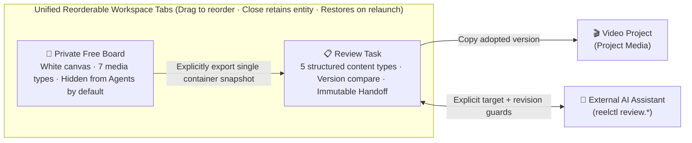

<div align="center">

[← Video Editor Home](README_en.md) &nbsp;·&nbsp; **🧪 Review Workspace (English)** | [简体中文](README_review.md)

# ReelTerminal · Review Workspace & Private Free Boards
### Batch curation, pixel repair, human-in-the-loop handoff, and a mixed-media scratchpad for AI assets

[**💡 Why Review Workspace?**](#-why-review-workspace) • [**🗂️ Unified Tabs & Privacy Boundary**](#️-unified-tabs--privacy-boundary) • [**🎨 Private Free Boards**](#-private-free-boards) • [**🤖 Agent CLI & Repair Workflow**](#-for-ai-agents-review--repair-cli) • [**📚 Documentation**](#-documentation)

</div>

> [!IMPORTANT]
> **Experimental Module**  
> The Review Workspace and Free Boards run independently without requiring an open video project. Built around personal workflows for AI asset curation, local pixel repair, and multi-round Agent rework, this module is under active iteration and its UI and command contracts may evolve rapidly.

---

## 💡 Why Review Workspace?

Before generated assets ever reach a video timeline, creators face heavy **upstream curation and rework**:

* **Scattered multimodal batches:** a single generation run can produce dozens of candidate images, storyboards, Markdown corpora, tabular data, video takes, and 3D GLB models. Comparing versions across folders or chat logs quickly becomes unmanageable.
* **Localized defects need surgical repair:** when a generated image has a minor artifact or a video clip has a few bad frames, annotating the region, painting a repair layer, or capturing an exact frame is far faster than regenerating the entire batch.
* **Private ideation vs. structured handoff:** creators need a strictly private canvas to arrange mixed-media references without an AI assistant reading or interrupting their scratchpad—and a way to publish an immutable, version-bound handoff snapshot once decisions are ready.

---

## 🗂️ Unified Tabs & Privacy Boundary

Review Workspace combines **Review Tasks** and **Private Free Boards** in a single **reorderable workspace tab strip** while enforcing a strict boundary between Agent-visible review nodes and private human boards:



- **Unified tab strip & management:** arrange review tasks and private free boards side by side, drag to reorder, and close tabs without deleting underlying data. Open tabs and their order restore automatically across restarts. The **Open / Manage** dialog organizes task categories, archives, the recycle bin, and saved boards in one place.
- **Target-aware address bar:** when a Review Task is active, the address bar provides a one-click `start --target <ref>` command for your Agent; when a Private Free Board is active, it clearly indicates that the board is private and exposes no Agent target.

---

## 📋 Review Tasks

Each Review Task represents an independent goal for **structured batch review and version-bound Agent rework**. Agents submit new batches or item revisions within the designated task rather than spawning separate tasks for retries:

| Capability | Highlights & Boundaries |
| :--- | :--- |
| **5 First-Class Content Types** | • **Image (`image`):** adaptive board or category grouping, integer-multiple pixel zoom, spatial annotations, and source-pixel repair.<br>• **Text (`text`):** Markdown reading view, live-preview Markdown editor, and exact character-range source annotations; saving creates a new version.<br>• **Structured Data (`data`):** tabular inspection, original-vs-proposed value comparison, cell-level patches, and explicit rework badges.<br>• **Video (`video`):** browser-timeline playback, range markers, and pre-bound baseline video side-by-side or overlay comparison.<br>• **3D Model (`model3d`):** lightweight read-only preview for self-contained GLB 2.0 triangle meshes (PBR, skinning, morph targets), dual-view comparison, and camera-viewpoint snapshot feedback. |
| **Scoped Pixel Repair & Exact Frame Capture** | • **Pixel repair & drafts:** brush, transparent-layer eraser, clone stamp, and image patches; supports CLI region inspection, multi-step unsaved repair drafts (`review.repair.draft.*`), and atomic single-version commits.<br>• **Exact frame capture:** `review.frames.capture` extracts an exact **zero-based decoded frame index with real source PTS** from a video item into a linked image item in the same task for immediate repair.<br>• **Flicker-free continuity:** consecutive CLI image updates preserve the decoded image, viewport zoom/pan, and focus; if a first repair image fails to decode, the viewer automatically falls back to the original image and reports the exact error. |
| **Immutable Handoff & Process Traceability** | • **Draft isolation:** keep, discard, and rework verdicts are undoable; unpublished draft feedback is never exposed to Agents.<br>• **Explicit handoff:** clicking **Publish decisions** freezes an immutable snapshot and waits for real Agent acknowledgement and version-bound rework.<br>• **Process view & CLI activity:** inspect recorded inputs, outputs, parameters, and candidate branches, pin two versions to compare, and monitor target-isolated real CLI activity logs (with sensitive text automatically redacted). |
| **Export & Project Attachment** | • Drag items or groups directly to your OS file manager, or export originals, current saved versions, human-adopted versions, or full node packages with history.<br>• **Attach adopted to project** copies human-adopted images or videos into an explicitly selected video project and workspace without altering its timeline. |

---

## 🎨 Private Free Boards

Built on **Excalidraw with a fixed `#FFFFFF` pure-white canvas**, Free Boards act as a **private mixed-media scratchpad**:

- **7 Mixed-Media Input Types on One Canvas:**
  - Drag or paste **images, plain text (`.txt`/`.log`), videos, 3D GLB models, Markdown (`.md`), local HTML (`.html`/`.htm`)**, or standalone **HTTP/S URLs** (created as web containers).
  - Capture the current video frame or 3D GLB viewpoint directly onto the board as an independent image; crop, rotate 90°, flip, or pixel-repair images in place.
- **Managed Document Assets & Isolated Native Browsing:**
  - Markdown imports retain only actually referenced local assets within the document directory and support source editing and relative-link navigation.
  - Local HTML generates an initial viewport PNG via an isolated Chromium view (loading only managed local assets with network disabled). Web URL containers display their link until you click **Enter browse**, which opens a fixed-area Chromium view (no Node/preload access) where you can navigate and **Capture current viewport & return to board**.
- **Region Freeze PNG & Single-File Drag-Out:**
  - **Region capture** composites source-resolution images, vector annotations, 1920px re-rendered 3D views, and saved document viewports into a crisp white-background PNG ready to **drag out to Explorer/Finder, copy to clipboard, save to disk, or append to the board**.
- **🔒 Strict Agent Isolation Contract:**
  - Free Boards are stored privately and **never enter Agent context, change feeds, handoffs, or repair CLI commands**.
  - Only when you select a single container and explicitly click **Export this item as a review node** does ReelTerminal create a formal review node snapshot from that item.

See 📖 **[Free Boards Guide (docs/HUMAN-BOARDS.zh-CN.md)](docs/HUMAN-BOARDS.zh-CN.md)** for full details.

---

## 🤖 For AI Agents: Review & Repair CLI

Review Workspace has its own **Agent edit permission toggle**, independent of video project permissions. External Agents can connect via `reelctl` even when no video project is open:

```powershell
# 1. Run the startup command copied from the Review Task address bar (binds explicit review target, no token)
reelctl start --target <rt1-review-ref>

# 2. Discover review capabilities and command schemas on demand (lightweight, zero environment probing)
reelctl tools review
reelctl tools review.content
reelctl tools review.image-repair
reelctl describe review.ingest
reelctl describe review.repair.draft.apply

# 3. Capture an exact zero-based decoded frame from a video item as a repairable image item
reelctl review frames capture --file exact-frame.json

# 4. Inspect pixel region -> preview multi-step repair draft -> commit atomically as one item version
reelctl review repair inspect --file inspect-region.json
reelctl call review.repair.draft.create --file draft-create.json
reelctl call review.repair.draft.apply --file draft-ops.json
reelctl call review.repair.draft.inspect --file draft-inspect.json
reelctl call review.repair.draft.commit --file draft-commit.json
```

> 📌 **Core Execution Contracts:**
> - **Explicit target binding:** all reads and writes must carry the explicit `target` (`reviewWorkspaceId`, `instanceId`, `nodeId`) and revision guards (`expectedNodeRevision` / `expectedItemVersion`). Never retarget silently when the GUI switches tabs or opens a private Free Board.
> - **Continue within the designated task:** use `review.ingest` for new batches, `review.items.submit` for full item replacements, and `review.repair.*` for scoped pixel repairs within the same task—do not create new tasks for retries or rework.

---

## 📚 Documentation

- 🎨 [**Free Boards Guide (Chinese)**](docs/HUMAN-BOARDS.zh-CN.md) — 7 media types, Markdown/HTML/web browsing, pixel repair, region PNG freeze, and explicit review-node export.
- ⚙️ [**Command API · Independent Review Workspace**](docs/COMMAND-API.md#independent-review-workspace) — `review.*` command families, `review.repair.*` / `draft.*` contracts, and `review.frames.capture`.
- 🧊 [**Review 3D (GLB) Preview Delivery**](docs/REVIEW-3D-PREVIEW-DELIVERY.md) — GLB 2.0 validation bounds, dual-view comparison, and viewpoint observation snapshots.
- 📖 [**Desktop User Guide · Review Workspace**](docs/USER-GUIDE.md#审阅工作台) — UI navigation, keyboard shortcuts, collection views, and node package backup/restore.
